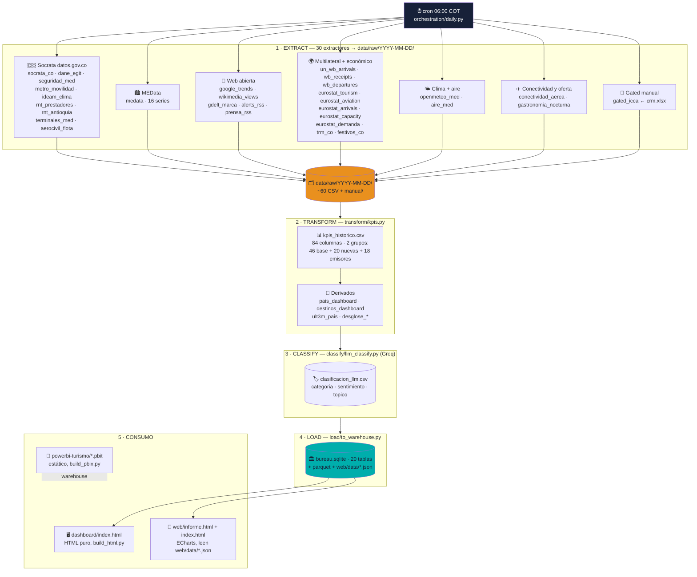

# Flujo operacional — Embudo Bureau Medellín

Corte verificado: 28-oct-2026. 30 extractores + kpis + classify + load + build = 34 pasos en `daily.py`. Cron `0 6 * * *` → `orchestration/daily.py`.

> Nota: `PBIT` es una foto estática (16 fuentes del catálogo) y no se alimenta del ETL diario. El tablero vivo es `dashboard/index.html`.

## Programas

| Programa | Rol | Entrada → Salida |
|---|---|---|
| `orchestration/daily.py` (+`cron_install.sh`) | Orquestador, 34 pasos, nunca tumba todo | — → llama a todos |
| `extract/*.py` (30) | Extracción Tier-1 + gated | APIs/Socrata/RSS → `data/raw/<hoy>/*.csv` |
| `transform/kpis.py` | Agregación: `kpis_marca/demanda/dane/gdelt/medata/pais/destinos/ult3m/desglose/nuevas/emisores` | raw → `data/processed/kpis_*.csv` + derivados |
| `classify/llm_classify.py` | Clasificación Groq (lotes 50, SKIP sin key) | alerts+prensa → `clasificacion_llm.csv` |
| `load/to_warehouse.py` | Publicación | PROC → sqlite + parquet + `web/data/*.json` |
| `dashboard/build_html.py` | Tablero estático sin JS | PROC → `dashboard/index.html` |
| `powerbi-turismo/build_pbix.py` | Plantilla estática | 17 CSV → `.pbit` |

## KPIs generados (84 columnas en `kpis_historico.csv`)

| Grupo | Ejemplos | Fuente que los alimenta |
|---|---|---|
| Base MICE (4) | win_rate, noches_mice, derrama_mice, pipeline_ponderado | `manual/crm.xlsx` |
| Demanda (6) | llegadas_medellin_nr, top1_emisor, share_top5, pax MDE/EOH | Socrata 7wm8/96sh/gb6w |
| DANE (5) | gasto_prom_dia_cop, dane_egit_ok/enh_ok | DANE EGIT (ENH bloqueado: ok=0) |
| Marca base (4) | menciones, sentimiento_neto, share_medellin, gdelt_vol_7d | alerts_rss (+GDELT, 0 hoy por 429) |
| MEData (10) | occ_med_ult, tarifa_med_ult, pits, mde_top_emisor_hist | 16 series MEData |
| Trimestre móvil (~10) | med_ult3m_total/yoy, ventana abr–jun 2026 | Socrata mensual |
| Nuevas vivas (20) | gasto_emisor_top_usd, pax_metro_mes, trm_hoy, rnt_med/ant, hurtos/homicidios, lluvia, pm2.5, pax_terminal_mes, prensa, wiki, festivos, eurostat x5, WB x2, aerocivil | Las 20 fuentes nuevas |
| Emisores/outbound (18) | emisor_top1-3, top5_share, crec_top (+168,9% El Salvador), destino_top (Bogotá), med_share 24,45%, salidas 5,8M top USA | pais/destinos_dashboard |
| LLM (pendiente key) | categoria, sentimiento, topico por titular | Groq, `clasificacion_llm.csv` |
